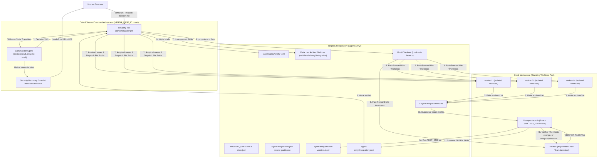

# Agent-Army Design Specification

- **Date:** 2026-11-07
- **Repository:** `/Users/hinchk/.gemini/antigravity/scratch/agent-army`
- **Status:** Approved

---

## 1. Intent and Why

Single-agent coding harnesses ("Single-Supertroop") preserve end-to-end context coherence and eliminate handoff loss, but suffer from context window saturation on multi-slice missions, self-justification bias during verification, and high frontier token burn on routine implementation tasks. Conversely, traditional multi-agent swarms ("Multi-Swarm") isolate context and enable parallel execution and model-cost arbitrage, but frequently degrade due to middle-manager "Frankenprompts" or stall at human-only integration gates between waves.

**Agent-Army** unifies both paradigms into an autonomous, mission-oriented agent organization:

1. **Out-of-Swarm "Special Forces" Commander (`pi` or `opencode`):** A single long-horizon, high-reasoning agent sitting *outside* the Herdr worker swarm (`HERDR_PANE_ID` unset). Driven by an event-based outer loop (`army run`), the Commander holds mission truth, decomposes work into non-overlapping waves, and authors dynamic role-play ("LARP") XML briefs for workers. It emits one `<commander_decision>` block. `lib/commander.py` is the only program that runs `arbiter drain`, `arbiter promote --confirm`, git, and Herdr.
2. **Zero-Trust Herdr Worker Swarm (`worker-1..N`, `verifier`):** A standing pool of isolated Git worktree seats inside a Herdr workspace, stripped of redundant in-swarm `looper` and `pm` middlemen ("Orchestration Collapse"). Workers execute bounded tasks under dynamic XML personas, while an independent `verifier` seat and mechanical exact-SHA test runner gate every commit before integration. Each task starts a fresh agent session on the existing pane.
3. **Mission-Complete or Security-Boundary Halt:** Agent-Army works a target repository across waves autonomously until the mission exit criteria pass or a **hard security boundary** (secrets/credentials, interactive logins/auth, deployments/external mutations, or merging to `origin/main` on GitHub) is encountered, at which point it halts fail-closed with a structured, resumable handoff receipt.

---

## 2. Goals, Non-Goals, and Anti-Goals

### Goals
- **Event-Driven Outer Commander Loop (`army run`):** Run the Commander in a persistent, resumable session outside Herdr that wakes only on state transitions (Wave Planning, Repair Triage, Mission Completion, or Security-Boundary Halt). A settled wave is drained by `commander.py` before that wake. `pi` starts with `--no-tools --no-context-files`. `opencode` starts with `--agent commander` (read allowed; bash, shell, edit, and write denied). The agent never receives a shell.
- **Orchestration Collapse (Standing Worktree Pool):** Replace Stampede's in-swarm `looper` and `pm` seats with the external Commander. Maintain a standing Herdr pool of isolated git worktree seats (`worker-1..N` on cost-fitted coding models + 1 independent `verifier` seat). The pane and worktree stay up. Each task, and each repair, starts a new agent session with `herdr agent start` on that pane.
- **Dynamic LARP XML Briefing:** Parameterize each delegated task with a file-based XML brief (`<role>`, `<objective>`, `<scope>`, `<owns>`, `<gates>`, `<security_boundaries>`, `<comms>`) tailored to the task's domain persona and delivered via short file-path prompts.
- **Zero-Trust Mechanical + Asymmetric Verification:** Require every worker task to pass the supervisor's independent execution of the project's `TEST_CMD` on the exact worker commit SHA, with that commit's paths inside `owns`. When the commit changes a test file, or the Commander sets `verify="asymmetric"`, the detached `verifier` seat must also pass. The Commander may add that review. It cannot remove it.
- **Mechanical Arbiter Drain & Local Promotion:** After a wave settles, `lib/commander.py` runs `arbiter drain` (merging gated SHAs onto `refs/heads/army/<slug>/integration` in a detached worktree and gating the combined tree) and, on success, local `arbiter promote --confirm` (fast-forwarding local `main`), then synchronizes the worktree pool so Wave $N+1$ branches from the newly integrated local `main`. The Commander agent does not run these commands.
- **Fail-Closed Security Boundaries & Resumable Handoff:** Detect and halt immediately before crossing security boundaries, pausing active tasks and writing `.agent-army/handoff.md` and `.agent-army/state.json` so a human can perform the privileged action and run `army resume`.

### Non-Goals
- **Custom Model Training / Soft-Token Projectors in v1:** Concepts from the exploration notes requiring neural weight training or frozen-LLM embedding projection (e.g., Memorilla soft memory tokens or Recursive Self-Improvement weight updates) are out of scope for v1. Long-horizon memory in v1 is handled via durable state checkpoints (`MISSION_STATE.md`, `.agent-army/state.json`) and native `pi`/`opencode` session persistence.
- **Replacing Herdr:** Herdr remains the terminal workspace, pane, and agent lifecycle manager.
- **Gate-less Repositories:** Target repositories without Git or without a runnable `TEST_CMD` (`""`, `none`, `true`) are rejected fail-closed at preflight.
- **Execution-time Sandbox:** v1 does not stop a worker command from starting. It detects a bad commit or a blocked agent afterward and halts. A network sandbox is a non-goal. Worker and verifier processes are started without `GITHUB_TOKEN`, `GH_TOKEN`, and `AWS_*`, and with `AWS_SHARED_CREDENTIALS_FILE`, `GOOGLE_APPLICATION_CREDENTIALS`, and `CLOUDSDK_CONFIG` pointed at a missing path. The outer `commander.py` process keeps its own credentials for the optional draft PR.

### Anti-Goals (Failure Conditions Even If Code Runs)
- **Crossing Security Boundaries Autonomously:** Merging a PR into `origin/main` on GitHub, force-pushing, reading/modifying production `.env` secrets or cloud credentials, running production deployments, or auto-approving interactive login/trust dialogs.
- **Self-Certified Green Verdicts:** Accepting a worker's or Commander's claim that tests passed without the supervisor independently executing the project's `TEST_CMD` against the exact commit SHA, verifying zero working-tree drift, and rejecting any path outside `owns`. A commit that changes a test file and skips the verifier is the same failure.
- **Continuous Commander Polling:** Keeping the Commander LLM in an active tool-call polling loop while workers execute, burning frontier tokens on `sleep`/status checks.
- **Raw Prompt Stuffing:** Pasting multi-line XML briefs directly into `herdr agent prompt`, which saturates the PTY canonical input buffer on macOS and silently truncates instructions.
- **Stale Worktree Base Drift:** Promoting integrated commits to local `main` without advancing idle worker worktrees to the new `main` before the next wave is dispatched.

---

## 3. Constraints & Invariants

1. **Platform & Toolchain Floor:**
   - macOS and Linux compatible; shell scripts must run under `/bin/bash` (Bash 3.2 compatibility floor, `set -euo pipefail`, 0 ShellCheck warnings).
   - Python 3.11+ with `tomllib` (resolved via `lib/pyenv.sh`), `jq`, `git`, `gh`, `timeout(1)` (or `gtimeout`/Python fallback), `herdr`, and `pi` or `opencode`.
2. **Commander External Context Invariant:**
   - The Commander process runs with `HERDR_PANE_ID` and `HERDR_ENV` unset (or explicitly stripped in the Commander subshell) so it never occupies a worker pane.
   - `_arb_promote_pane_check` in `lib/arbiter.sh` continues to block any recognized Herdr agent pane (`HERDR_PANE_ID` occupied by a live Herdr agent) from running `promote`, while permitting the outer `commander.py` process.
   - When `army` control commands (`army up`, `army status`, `supervisor.sh`) talk to Herdr from the outer loop, they target the explicit Herdr workspace ID recorded in `.agent-army/seats.json` (discovered by strict physical CWD match of the target repo), never relying on ambient `$HERDR_WORKSPACE_ID` or `--current`.
   - The Commander agent has no shell, no edit, and no write. `commander.py` parses one `<commander_decision>` block and ignores every other line of model output. It never passes model text to a shell.
3. **Seating Order Invariant:**
   - Before `worktree_provision`, append `.agent-army/` to the target repo's `.git/info/exclude` if that line is absent. That file is shared by every worktree, it is not a commit, and it does not appear in `git status --porcelain`. The supervisor rejects any worker commit that touches `.agent-army/`.
   - `herdr agent start` inherits the pane's CWD fixed at `herdr pane split --cwd`. Isolated seats (`worker-1..N`, `verifier`) must always execute in exact order:
     `exclude .agent-army/` $\rightarrow$ `worktree_provision` $\rightarrow$ `herdr pane split --cwd <worktree_dir> --no-focus` $\rightarrow$ `herdr agent start <seat>-<slug> --kind <kind> --pane <pane_id>` $\rightarrow$ atomic record in `.agent-army/seats.json`.
4. **Git Worktree Safety Rules:**
   - Never run `git stash` (stash stack is global across worktrees).
   - Never run `git worktree remove --force` on a dirty worktree without first salvaging uncommitted diffs and untracked files to `.agent-army/snapshots/<timestamp>/<seat>/`.
   - Never move a checked-out branch from outside its worktree (`main` is only fast-forwarded via `git -C <repo_root> merge --ff-only army/<slug>/integration` after verifying the root worktree is on `main` and `git status --porcelain` is empty). Ignored files do not make the root dirty.
5. **Gate Environment:**
   - Every `TEST_CMD` (the per-commit supervisor gate and the arbiter's combined-tree gate) runs under `env -i` with `PATH`, `HOME`, `CI=true`, and the toolchain variables the target profile names. `CI` is set to `true` inside the gate, including when the caller has it unset, so Jest and Vitest do not enter watch mode. `HERDR_*`, `REPO_DIR`, and `STATE_DIR` are never passed through. The worker process environment and the gate environment are not the same.
6. **Arbiter Lock:**
   - A lock holder whose pid is dead, or whose `ps -o state=` value starts with `T` (stopped, including `T`, `TN`, and `T+`), is stale and is reaped. `kill -0` is not the liveness check: it succeeds for a stopped process.
7. **One Slug:**
   - Preflight reads `[army].name` once, runs `slugify()` on it, and stores the result in `.agent-army/state.json` as `slug`. Every ref, seat name, and branch reads that field. Nothing derives a second slug from the directory name or the GitHub repo.
8. **One Run:**
   - `army run` takes an exclusive `fcntl` lock on `.agent-army/army.lock` before any other work and exits immediately if the lock is already held. `fcntl` is the lock; macOS does not ship `flock(1)`.
9. **No Progress:**
   - `state.json` keeps `zero_integrate_waves`. A settled wave that promotes no commit increments it. A wave that promotes at least one commit sets it to 0. When it reaches 2, `commander.py` writes `.agent-army/handoff.md` and exits `MISSION_BLOCKED`. `max_waves` remains the outer cap.

---

## 4. Approaches Considered

### Approach 1 (Selected): Self-Contained `agent-army` Repo Porting Stampede's Mechanical Core + Python Commander Engine
- **Description:** Vendor and adapt Stampede's proven Bash/Python mechanical libraries (`arbiter.sh`, `worktree.sh`, `partition.sh`, `profile.sh`, `providers.sh`, `lifecycle.sh`, `telemetry.py`) into `agent-army/lib/`, removing `looper` and `pm`. Add a dedicated Python Commander & Wave Controller (`lib/commander.py`) and unified `bin/army` CLI that drives `pi`/`opencode` in an event-driven outer loop, generates LARP XML briefs, enforces security boundaries, and runs the `drain` $\rightarrow$ `promote` $\rightarrow$ worktree-sync cycle between waves. The `arbiter.sh` port keeps the CAS ref update and changes two behaviors that failed in Stampede: the gate uses the clean environment in §3, and a stopped lock holder is reaped.
- **Trade-offs:** Copies ~6 core library modules from Stampede, but keeps `agent-army` 100% self-contained while preserving battle-tested git CAS ref locks, TOCTOU drift checks, OpenCode `.opencode/opencode.json` model pinning, and PTY-safe file briefing.

### Approach 2: Greenfield Pure-Python Orchestrator
- **Description:** Build a brand-new Python package from scratch using `wt`-style file mailboxes and custom `subprocess` wrappers around `git` and `herdr`.
- **Trade-offs:** Single language, but re-invents CAS ref integration, detached worktree gating, lock reaping, and Herdr TUI readiness workarounds that Stampede already hardened across 27 test suites.

### Approach 3: Thin Wrapper Over an External `stampede` Checkout
- **Description:** Keep `stampede` as an external runtime dependency and write a wrapper script that invokes `stampede` CLI commands.
- **Trade-offs:** Minimal new code, but conflicts with Stampede's core assumptions (mandatory root `looper` seat, fixed `arch`/`pm` roles instead of dynamic LARP XML personas, and no mid-mission worktree base advancement after `promote`).

**Decision:** **Approach 1** was selected because it preserves Stampede's git CAS updates and Herdr seating rules, including the gate-environment and stopped-lock adaptations above, while re-architecting orchestration around the out-of-swarm Commander and LARP wave loop.

---

## 5. System Architecture ("The How")



### 5.1 Repository Structure (`/Users/hinchk/.gemini/antigravity/scratch/agent-army`)

```text
agent-army/
├── Makefile                        # make check (lint + all test suites), make test, make lint
├── README.md                       # Quickstart, architecture, security boundaries, CLI reference
├── CLAUDE.md                       # Agent engineering conventions & safety invariants
├── STATE.md                        # Active build checkpoint
├── army.config.toml.example        # Default configuration template
├── bin/
│   └── army                        # Main CLI entry point
├── briefs/
│   ├── commander.sys.md            # Commander system prompt & XML output contract
│   └── commander.opencode.json     # opencode commander agent: read allowed; bash, shell, edit, write denied
│   ├── worker.in.md                # Standing worker bootstrap brief template
│   └── verifier.in.md              # Standing asymmetric verifier bootstrap brief template
├── lib/
│   ├── common.sh                   # Logging, slugify() (called once), evidence hashing, workspace CWD lookup
│   ├── pyenv.sh                    # Python 3.11+ (tomllib) resolver
│   ├── preflight.sh                # Dependency, harness, model, and Herdr session preflight
│   ├── config.sh                   # Parses army.config.toml -> shell exports
│   ├── profile.sh                  # Fail-closed target repo, TEST_CMD, and test_globs
│   ├── worktree.sh                 # Worktree provisioning, pool base-sync, snapshot salvage
│   ├── partition.sh                # `owns:` file-path overlap checker & lease manager
│   ├── providers.sh                # Harness launch (pi, opencode, claude, agy, codex) & model pinning
│   ├── briefs.sh                   # File-path brief renderer & nonce delivery
│   ├── lifecycle.sh                # Herdr workspace/pane seating, verify, selective teardown
│   ├── supervisor.sh               # Harvests worker/verifier anchors, runs TEST_CMD, enqueues SHAs
│   ├── arbiter.sh                  # Detached combined-tree gate, CAS ref update, local main promote
│   ├── telemetry.py                # JSONL event logger (session-verdicts.jsonl). No ops pane, no ANSI stream
│   └── commander.py                # Outer event loop, pi/opencode session driver, LARP XML & boundary engine
└── tests/
    ├── test_preflight.sh
    ├── test_config_profile.sh
    ├── test_worktree_sync.sh
    ├── test_partition_leases.sh
    ├── test_supervisor_verifier.sh
    ├── test_arbiter_promote.sh
    ├── test_security_boundaries.sh
    └── test_commander_loop.py
```

### 5.2 Configuration Schema (`<target_repo>/army.config.toml`)

`army setup <target_repo>` inspects installed harnesses (`pi`, `opencode`, `claude`, `agy`, `codex`) and writes `<target_repo>/army.config.toml`:

```toml
[army]
name = "my-project"
base_branch = "main"
max_waves = 15
max_repairs_per_task = 1
task_timeout_sec = 1800             # Per-task clock. One re-dispatch, then BLOCKED.
create_draft_pr_on_complete = false

[commander]
harness = "pi"                      # "pi" or "opencode"
model = "anthropic/claude-sonnet-4-5"
thinking = "high"                   # Passed to pi --thinking when harness = "pi"
timeout_sec = 600

[seats.worker_1]
kind = "opencode"
model = "zai-coding-plan/glm-5.3"
role = "worker"
worktree = true
critical = true

[seats.worker_2]
kind = "opencode"
model = "zai-coding-plan/glm-5.3"
role = "worker"
worktree = true
critical = false

[seats.verifier]
kind = "claude"
model = "sonnet"
role = "verifier"
worktree = true
critical = true
```

Adding `worker_3..N` is a TOML table addition only; no shell scripts hardcode seat counts.

### 5.3 Event-Driven Commander State Machine (`lib/commander.py`)

When the user runs:
```bash
army run <target_repo> --mission <mission_file.md> [--commander pi|opencode] [--model <model>]
```

`lib/commander.py` takes the `.agent-army/army.lock` from §3 and exits immediately if that lock is held. It then executes the following state machine outside Herdr (explicitly unsetting `HERDR_PANE_ID` and `HERDR_ENV` in its own process and any `arbiter` / `commander` subprocesses, while passing explicit `--workspace <ws_id>` when calling `herdr` for worker panes):

1. **`PREFLIGHT_AND_SEAT`:**
   - Validates target repo profile (`lib/profile.sh ensure`), ensuring a runnable `TEST_CMD` and clean root checkout on `base_branch` (`main`).
   - Reads `[army].name` once, stores `slug` in `.agent-army/state.json`, and uses only that value for `refs/heads/army/<slug>/integration` and for seat names (`<seat>-<slug>`).
   - Ensures the Herdr workspace and standing seats (`worker-1..N`, `verifier`) are seated and idle (`army up <target_repo> --seat-only`). Worker and verifier processes are started with the credential-free environment in the execution-time sandbox non-goal. Initializes `refs/heads/army/<slug>/integration` at `main` HEAD if not yet present (`arbiter.sh init-ref`).
   - Creates or loads `.agent-army/state.json` and `.agent-army/MISSION_STATE.md`. `zero_integrate_waves` starts at 0.

2. **`WAKE_COMMANDER_PLAN`:**
   - Invokes the Commander harness non-interactively with session persistence. `commander.py` writes `.agent-army/commander-prompt.md` first. The agent cannot run `army`, `herdr`, or `git`.
     - **`pi`:** `pi -p --no-tools --no-context-files --session .agent-army/commander-session.jsonl --model <model> --thinking <level> --append-system-prompt .agent-army/commander-prompt.md "Emit only the <commander_decision> block."` `--append-system-prompt` reads that file into the prompt. `--no-tools` disables bash, edit, and write. `--no-context-files` skips the target repo's `AGENTS.md` and `CLAUDE.md`.
     - **`opencode`:** `OPENCODE_CONFIG=<agent-army>/briefs/commander.opencode.json OPENCODE_CONFIG_PROJECT_DISABLE=1 opencode run --session <session_id> --agent commander "Read .agent-army/commander-prompt.md and emit only the <commander_decision> block."` The message is a positional argument. `--prompt` is not a flag of `opencode run`. The agent file denies `*`, then allows `read`, and denies `bash`, `shell`, `edit`, and `write`. `OPENCODE_CONFIG_PROJECT_DISABLE=1` keeps a target-repo config from handing those tools back.
   - `commander.py` reads stdout and accepts one `<commander_decision>` block. Every other line is ignored and is never passed to a shell.
   - The prompt file `.agent-army/commander-prompt.md` contains:
     - Mission specification path and contents summary
     - Current `MISSION_STATE.md` (completed waves, integrated commits, open items)
     - Current repo status (`git log -n 10 --oneline`, directory tree summary, idle worker seats)
     - Latest wave receipts (if waking after a wave)
   - The Commander responds with one `<commander_decision>` XML block on stdout. It has no write tool, so it does not write the file itself. `commander.py` is what stores the block. The block chooses one of three actions:
     - `action="dispatch_wave"`: Defines tasks for the next wave.
     - `action="mission_complete"`: Declares all mission exit criteria satisfied. If the GREEN queue is non-empty, `commander.py` drains and promotes it first, then runs the final full-repo `TEST_CMD` under the clean gate environment.
     - `action="mission_blocked"`: Declares a security boundary or unresolvable blocker.
   - Drain and promote are not actions. When a wave settles with a non-empty GREEN queue, `commander.py` drains and, on success, promotes before this wake.

3. **`DISPATCH_WAVE`:**
   - A wave assigns at most one task to each worker seat. When a decision lists more tasks than live worker seats, `commander.py` dispatches the first task per seat and keeps the rest. The kept tasks go out on the next dispatch wave, ahead of any newly planned task. A pending conflict-resolution task (step 5) goes ahead of the kept tasks. Two prompts are never sent to the same seat in one wave.
   - For each task actually dispatched:
     - **Security Boundary Pre-Check:** Scans the task's `<objective>`, `<scope>`, and `<gates>` against the Security Boundary rules (§5.5). If a task asks a worker to cross a boundary, halts immediately as `MISSION_BLOCKED`.
     - **Partition Lease Check:** Calls `lib/partition.sh` to verify that the comma-separated `owns:` file paths of all tasks in the wave are mutually disjoint. Acquires leases in `.agent-army/leases.json`.
     - **LARP XML Brief Rendering:** Writes `.agent-army/briefs/<wave>-<task_id>.xml` (schema in §5.4) into the assigned worker's worktree (`.agent-army/worktrees/<seat>/.agent-army/briefs/<wave>-<task_id>.xml`). That path sits under `.agent-army/`, which `.git/info/exclude` ignores.
     - **Short Prompt Delivery:** Runs `herdr agent start` on the existing pane so the session is new, deletes `<worktree>/.agent-army/anchors/<task_id>.txt` for that seat, then sends a <200-byte prompt to `<seat>-<slug>` via `herdr agent prompt`:
       `Read .agent-army/briefs/<wave>-<task_id>.xml, execute the task within scope, commit your work, and write the completion anchor file.`
     - The task clock starts at this prompt. The limit is `task_timeout_sec` (default 1800). A repair and a timeout re-dispatch do the same: new session, anchor file deleted, then the prompt. The pane and the worktree are not recreated.

4. **`SUPERVISE_WAVE` (Commander Asleep — Zero Commander Token Burn):**
   - `lib/supervisor.sh` waits until every dispatched task in the wave reaches a terminal state (`GREEN`, `RED`, or `BLOCKED`):
     - The worker writes the anchor line to `<worktree>/.agent-army/anchors/<task_id>.txt`, the worktree path recorded for that seat in `.agent-army/seats.json`. The supervisor reads that path. It ignores the file when the file is missing or its modification time is earlier than the prompt that started the attempt. One `herdr agent read` is the backup, and only when the file is absent. A line that scrolled off the pane is not an anchor.
     - The same rule covers `WORKER BLOCKED`. The verifier writes `<verifier-worktree>/.agent-army/anchors/<task_id>.verify.txt`.
     - On `WORKER DONE #<task_id> <sha>`, the supervisor verifies `<sha>` exists in git and has no uncommitted worktree drift. It rejects the SHA when `git diff --name-only <base>...<sha>` contains a path outside that task's `owns`, or any path under `.agent-army/`. `<base>` is the integration tip the seat branched from.
     - It then runs the project's `TEST_CMD` in that worktree under the clean gate environment (§3). A red result is run once more before it counts. That extra run does not increment `repairs_used`. A green rerun is a green task. The brief cannot name a different test command.
     - The verifier is required when the Commander set `verify="asymmetric"`, and also when any changed path matches the profile's `test_globs`. Default globs: `test/**`, `tests/**`, `__tests__/**`, `test_*`, `*_test.*`, `*.test.*`, `*_spec.*`. There is no brief attribute that turns this off. The supervisor writes `.agent-army/briefs/<wave>-<task_id>-verify.xml` into the verifier worktree, deletes that task's verifier anchor file, and prompts `verifier-<slug>`. The verifier audits one commit at a time. The next audit waits until `<verifier-worktree>/.agent-army/anchors/<task_id>.verify.txt` exists and its modification time is later than that prompt. The verifier inspects `git diff <base>..<sha>` and writes `VERIFIER PASS #<task_id> <sha>` or `VERIFIER FAIL #<task_id> <sha> <reason>` to that file.
     - Before enqueue, the supervisor walks every new blob between the integration tip and `<sha>` (`git rev-list --objects <integration>..<sha>`) and applies the `SECRET` scan in §5.5. A secret added and later deleted still blocks.
     - Tasks passing all gates are enqueued via `arbiter.sh enqueue <task_id> <seat> <sha>`.
     - If a task fails `TEST_CMD` (after the extra run) or `VERIFIER FAIL` once and `repairs_used < max_repairs_per_task`, the supervisor writes the gate log path into a repair brief, starts a new agent session on that seat, and prompts it once.
     - If a worker writes `WORKER BLOCKED #<task_id> <boundary_type> <reason>` or Herdr reports `agent_status == "blocked"`, the supervisor records the block and stops waiting on that seat.
     - When a task reaches `RED` or `BLOCKED` and its commit is not queued, the supervisor releases that task's lease in `.agent-army/leases.json`.
     - If the task clock expires, the supervisor snapshots the worktree to `.agent-army/snapshots/<timestamp>/<seat>/`, starts a fresh agent session on that same pane with `herdr agent start`, and dispatches the same brief once. A second expiry records the task `BLOCKED` and puts the snapshot path on the wave receipt. The Commander sees that receipt when the wave settles and triages it. `commander.py` does not start another wave while this one still has a seat in flight, and it does not dispatch that task again.

5. **`ARBITER_DRAIN_AND_PROMOTE` (`commander.py` owns integration):**
   - Once the wave settles, if the GREEN queue is non-empty, `commander.py` drains it before waking the Commander. An empty queue skips this step and wakes the Commander to plan.
     1. `arbiter_drain` merges each queued GREEN `<sha>`, in queue order, onto `refs/heads/army/<slug>/integration` in the detached `.agent-army/worktrees/arbiter-<slug>` worktree, runs `TEST_CMD` on the combined tree under the clean gate environment, and CAS-updates `refs/heads/army/<slug>/integration` only when that gate is green. The arbiter lock reaps a dead holder, or a holder whose `ps` state starts with `T`, before taking the lock (§3).
     2. On `conflict` or `integration_red` at record R, the drain stops. R and every later record stay `queued`. The integration ref stays at the last green commit. The lock is released. This wave promoted nothing, so `commander.py` increments `zero_integrate_waves`. At 2 it writes `.agent-army/handoff.md` and exits `MISSION_BLOCKED` instead of continuing.
     3. `commander.py` wakes the Commander for exactly one resolution task. That task's base is the integration tip. On `conflict`, its `owns` is every path in R's commit. On `integration_red`, its `owns` is the paths in the failing SHA. `commander.py` moves the lease those paths already hold onto this task. It refuses a decision whose `owns` differs or whose wave contains any other task. The task is otherwise a normal wave task (anchor file, project `TEST_CMD`, `owns` check).
     4. The resolution task's GREEN sha is drained before R. A green drain of that sha marks R `superseded`. `commander.py` then drains the later queued records before the next planning wake.
     5. If `arbiter_drain` succeeds, `commander.py` runs `arbiter_promote --confirm`. That verifies the root checkout is on `main` and `git status --porcelain` is empty, runs `git -C <repo_root> merge --ff-only army/<slug>/integration`, marks the records `promoted`, and releases their file leases in `.agent-army/leases.json`.
     6. **Worktree Pool Synchronization (`worktree_sync_pool`):** Immediately after local `main` advances, `lib/worktree.sh` iterates over all idle `worker-N` and `verifier` worktrees, verifies they are clean, and resets/fast-forwards their seat branches (`army/<slug>/<seat>`) to the new `main` HEAD.
   - After a successful drain and promote, `commander.py` sets `zero_integrate_waves` to 0. When the queue was empty, it increments that counter. At 2 it writes `.agent-army/handoff.md` and exits `MISSION_BLOCKED` without another plan wake. Otherwise it wakes the Commander with the wave receipt so it can plan, finish, or block.

6. **`MISSION_COMPLETE` vs. `MISSION_BLOCKED`:**
   - **`MISSION_COMPLETE`:** If the GREEN queue is non-empty, `commander.py` drains and promotes it first. It then runs the final verification `TEST_CMD` on local `main` under the clean gate environment, updates `MISSION_STATE.md`, writes `.agent-army/COMPLETE.md` summarizing all integrated commits and test receipts, and—only if `create_draft_pr_on_complete = true`—pushes `army/<slug>/integration` and opens a **draft** PR (`gh pr create --draft`), stopping strictly before merging to `origin/main`.
   - **`MISSION_BLOCKED`:** `commander.py` writes `.agent-army/handoff.md` and `.agent-army/state.json` (status `blocked`) detailing the exact security boundary or blocker encountered, the exact human command/action required, and the `army resume <target_repo>` command to continue once resolved.

---

### 5.4 Dynamic LARP XML Briefing & Anchor Protocol

`commander.py` writes each task brief to `.agent-army/briefs/<wave>-<task_id>.xml` from the decision block. The agent supplies the fields and does not write the file. The file uses a strict XML structure inspired by Charles Chen's inverted LARP pattern:

```xml
<task_brief id="W1-T1" wave="1" seat="worker_1" verify="asymmetric">
  <role title="Staff Backend Security Engineer">
    You are a Staff Backend Security Engineer specializing in fail-closed authentication middleware and deterministic unit testing. You distrust happy-path assumptions and write minimal, surgical diffs.
  </role>
  <objective>
    Implement token signature validation and expiry checks in `src/auth/token.py` with full unit test coverage in `tests/test_token.py`.
  </objective>
  <scope>
    <read>src/auth/token.py, src/auth/types.py, tests/test_token.py</read>
    <owns>src/auth/token.py, tests/test_token.py</owns>
    <forbidden>Do not modify any file outside &lt;owns&gt;. Do not install external packages.</forbidden>
  </scope>
  <gates>
    <done_criteria>
      1. Expired tokens raise TokenExpiredError.
      2. Tampered signatures raise InvalidSignatureError.
      3. All existing and new tests pass with 0 warnings.
    </done_criteria>
  </gates>
  <security_boundaries>
    STOP IMMEDIATELY and emit WORKER BLOCKED if completing this task requires:
    - Real API keys, production secrets, or modifying .env / credential stores
    - Interactive login, OAuth, SSO, or 2FA
    - Deploying to external services or mutating remote databases
    - Pushing to git remotes or merging to main on GitHub
  </security_boundaries>
  <comms>
    Do not narrate long explanations in terminal output. Commit your changes on your current branch. Write exactly one line to `.agent-army/anchors/W1-T1.txt` in this worktree (excluded by `.git/info/exclude`) and print that same line:
    - On success: WORKER DONE #W1-T1 &lt;40-char-commit-sha&gt;
    - On security boundary or blocker: WORKER BLOCKED #W1-T1 &lt;SECRET|AUTH|DEPLOY|GITHUB_MAIN|SCOPE&gt; &lt;one-line reason&gt;
  </comms>
</task_brief>
```

The sample brief owns `tests/test_token.py`, so the verifier runs even if `verify="asymmetric"` were omitted. The Commander may set the attribute to add a review on a task that does not touch tests. No value of the attribute skips the verifier after a test file changes. The `verifier` seat receives a companion `<verifier_brief>` instructing it to roleplay a **Principal Adversarial Code & Security Auditor** whose sole job is to find spec violations, regressions, unowned file touches, or security boundary leaks in `<sha>`. It writes one line to `<verifier-worktree>/.agent-army/anchors/<task_id>.verify.txt`:
- `VERIFIER PASS #<task_id> <sha>`
- `VERIFIER FAIL #<task_id> <sha> <one-line actionable defect>`

---

### 5.5 Hard Security Boundaries & Enforcement

Agent-Army enforces four non-negotiable security boundaries across three layers (Commander pre-dispatch check, Worker/Verifier prompt + Git diff check, and Arbiter/CLI guard):

| Boundary Code | What Triggers a Halt | Mechanical Enforcement Layer |
| :--- | :--- | :--- |
| `GITHUB_MAIN` | Merging a PR on GitHub (`gh pr merge`), pushing directly to `origin/main` or `origin/master`, force-pushing, or modifying repo branch protections/settings. | `arbiter.sh` only fast-forwards *local* `main` (`merge --ff-only`). No script ever invokes `gh pr merge` or `git push origin main`. Worker worktrees have no push permission in briefs; supervisor rejects commits touching `.github/workflows` unless explicitly listed in mission scope. |
| `SECRET` | Reading, generating, rotating, or committing real API keys, `.env` secrets, private SSH/PGP keys, cloud credentials (`~/.aws`, `~/.config/gcloud`), or keychain tokens. | Before enqueue, the supervisor scans every new blob between the integration tip and `<sha>`, not the net diff of the tip. A path or blob matching `.env*`, `*.pem`, `*.key`, a private-key header, or a token prefix (`sk-`, `ghp_`, `AKIA`) is `BLOCKED: SECRET`. A secret added in an ancestor and deleted at the tip still blocks. |
| `AUTH` | Interactive login flows (`gh auth login`, `gcloud auth`, OAuth browser redirects, 2FA/SSO prompts) or Herdr TUI permission/trust dialogs (`agent_status == "blocked"`). | `supervisor.sh` monitors `herdr agent get <seat>` for `blocked` status and reads `WORKER BLOCKED #<id> AUTH ...` from that seat's `<worktree>/.agent-army/anchors/<task_id>.txt`, immediately pausing the task and escalating to Commander $\rightarrow$ Human Handoff. |
| `DEPLOY` | Running production/staging deployments (`terraform apply`, `kubectl apply`, `fly deploy`, `vercel --prod`, `npm publish`), remote DB migrations, or external webhooks. | Commander boundary scanner flags deploy commands in task plans; workers emit `WORKER BLOCKED #<id> DEPLOY ...` when a mission step requires live deployment or external infrastructure mutation. |

When any boundary is triggered:
1. The outer loop stops dispatching new waves and leaves running worktrees intact for inspection.
2. `lib/commander.py` writes `.agent-army/handoff.md` containing:
   - **Boundary Triggered:** (`GITHUB_MAIN` | `SECRET` | `AUTH` | `DEPLOY`)
   - **Progress So Far:** Waves integrated into local `main` (with commit SHAs and test receipts)
   - **Exact Action Required from Human:** Step-by-step instructions or commands for the operator
   - **How to Resume:** `army resume <target_repo>`
3. `army run` exits with a dedicated exit code (`exit 20` for security boundary halt, `exit 0` for mission complete, `exit 1` for error).

---

## 6. What Is Left to the Builder

The following implementation details are intentionally left to the builder during planning and execution. The review rules are not open: decision-only commander launch, drain before the next plan, anchor files under the seat worktree from `seats.json` (deleted on every prompt, ignored when older than that prompt), the clean gate environment with `CI=true`, `.agent-army/handoff.md` as the only handoff filename, the secret scan across every new blob, `owns` plus one verifier audit at a time, the conflict queue with `owns` covering every path in the stranded commit, lease release on `RED` and `BLOCKED`, `.git/info/exclude` for `.agent-army/`, reaping a lock holder whose `ps` state starts with `T`, `task_timeout_sec`, and one task per worker seat. `tests/test_commander_loop.py`, `tests/test_supervisor_verifier.sh`, `tests/test_arbiter_promote.sh`, and `tests/test_security_boundaries.sh` are the suites that cover them.
- Internal Python module decomposition if `lib/commander.py` is split into smaller submodules (e.g., `lib/commander/loop.py`, `lib/commander/larp.py`, `lib/commander/boundaries.py`).
- Exact regex list for the pre-gate secret scanner in `lib/supervisor.sh` beyond the paths and prefixes in §5.5. The scan range is fixed: every new blob from the integration tip to the worker SHA.
- Exact test fixture construction in `tests/` (mock `herdr`, mock `pi`/`opencode` binaries for deterministic offline CI testing via `make check`).

Also closed: one `slug` in `state.json` from `[army].name`, a new agent session on the existing pane for every task and repair, `CI=true` plus one extra `TEST_CMD` before a red counts, `zero_integrate_waves` reaching 2 ends as `MISSION_BLOCKED`, an exclusive `fcntl` lock on `.agent-army/army.lock`, credential-free worker and verifier processes, and no ops pane. `telemetry.py` only appends JSONL.
